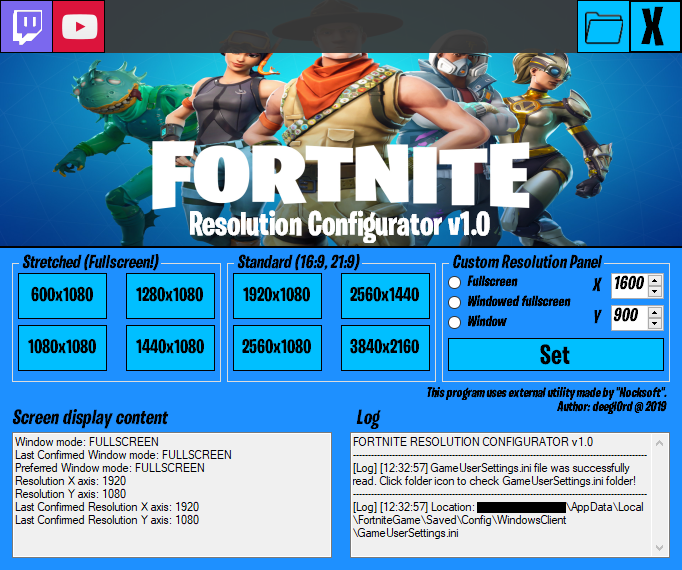
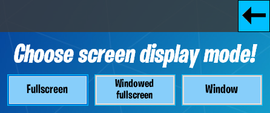

 # Fortnite Resolution Configurator
 
This is a WinForms application written in C#, made for the video game "Fortnite", 
to provide a way to change in-game resolution offline.
You have the ability to choose resolutions with common aspects ratios, non-conventional or else 'stretched' resolutions, or a custom resolution.

*This project uses external utility for the reading/writing of INI files developed by Nocksoft
Official website: https://nocksoft.de/*

### Preview pictures:

